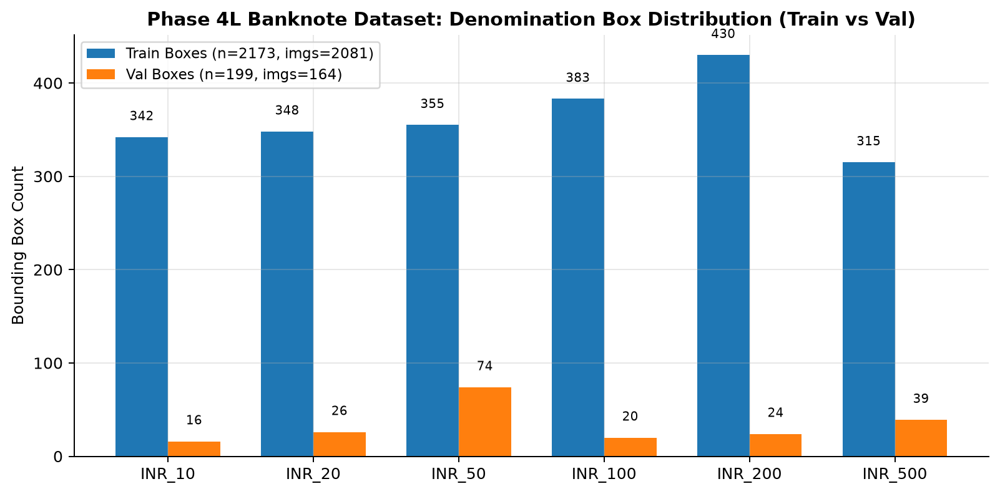
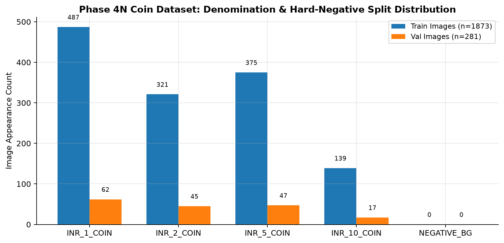
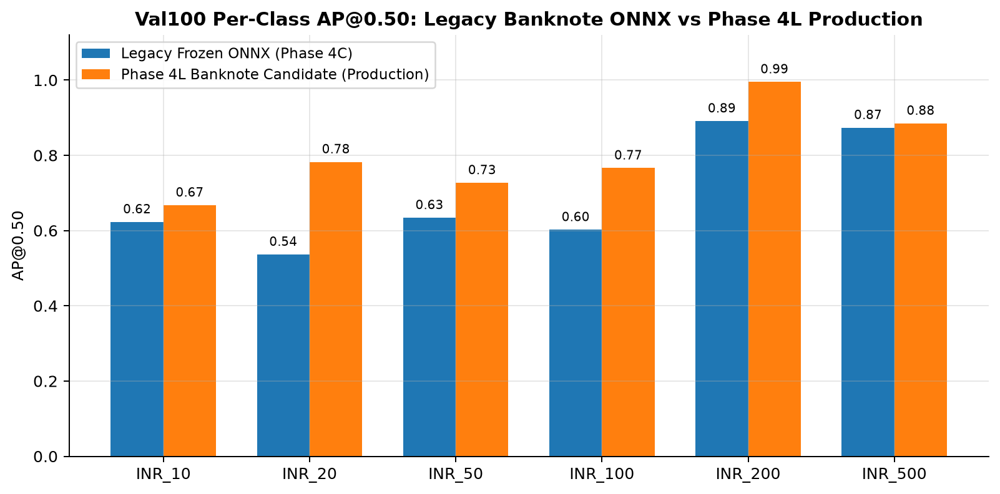
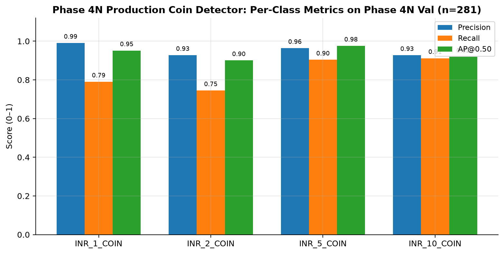
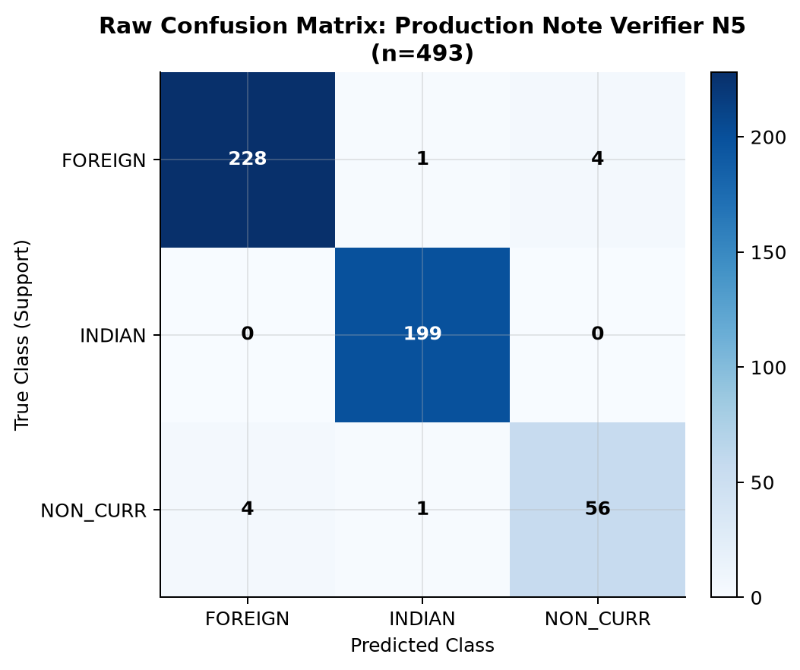
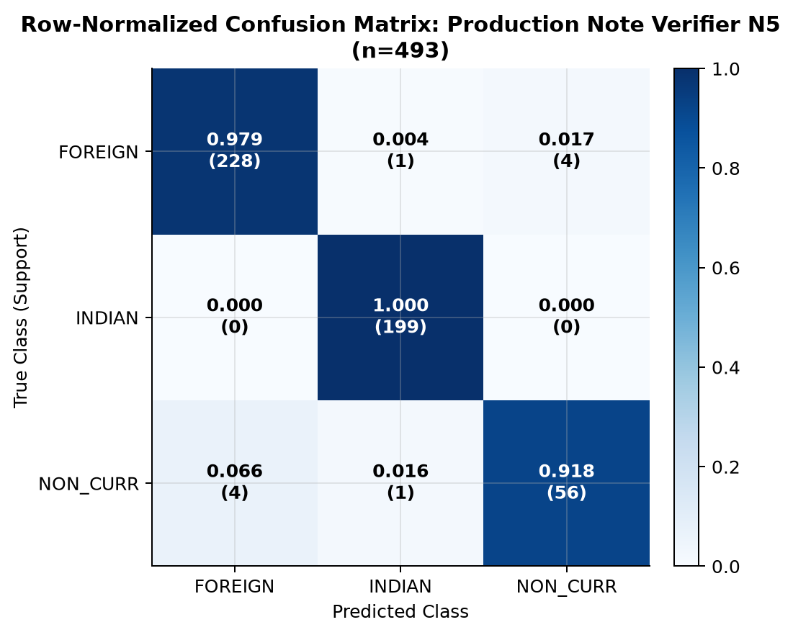
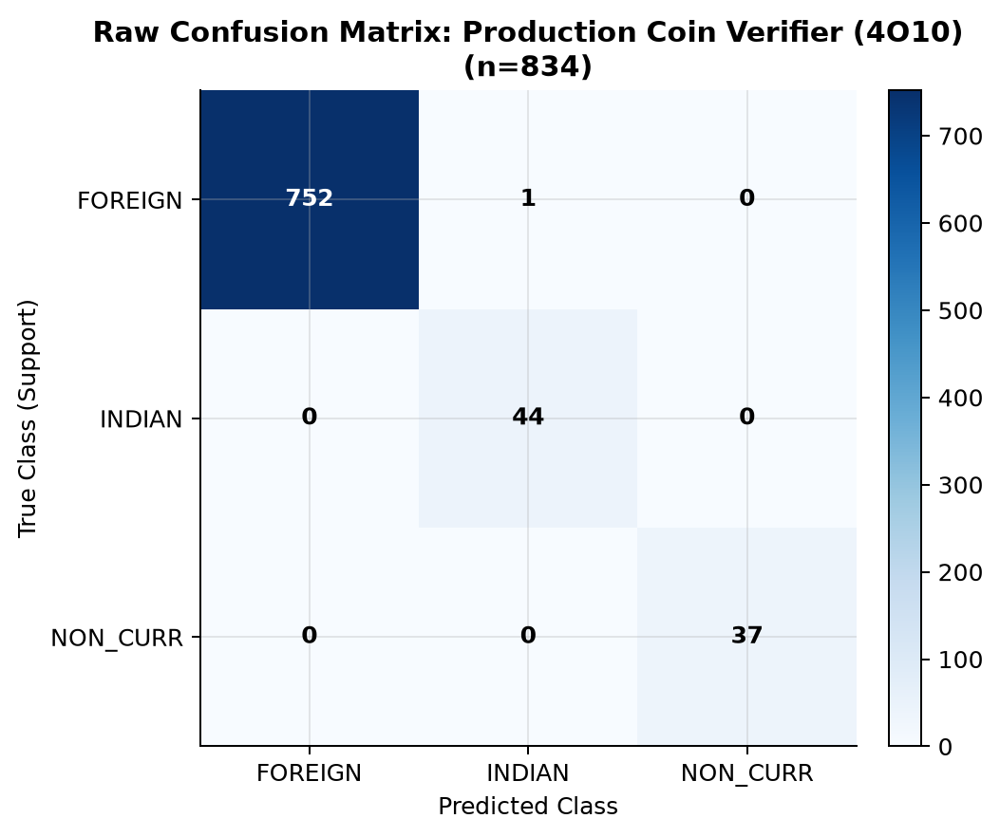
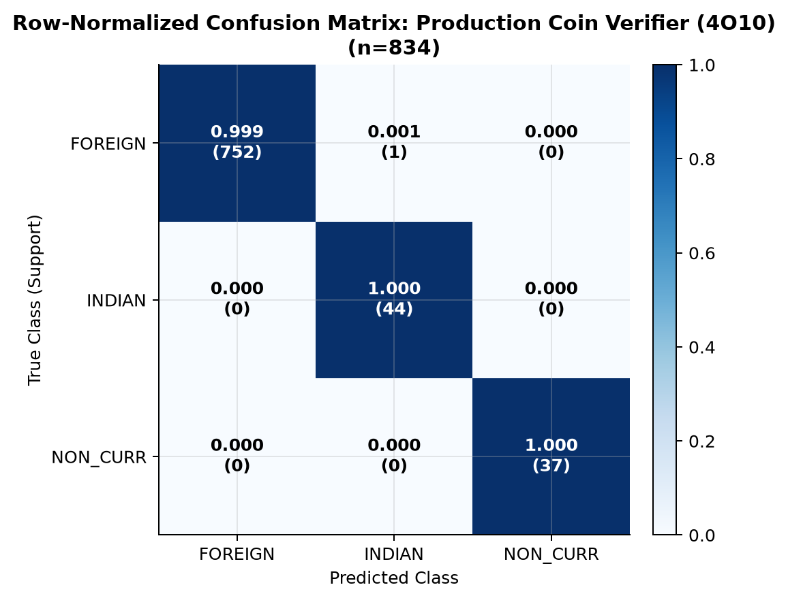

# CURRENCY SUBSYSTEM FINAL REPORT

## 1. Pipeline Architecture
Sanetra recognizes **6 Indian banknote denominations** (`INR_10`, `INR_20`, `INR_50`, `INR_100`, `INR_200`, `INR_500`) and **4 coin denominations** (`INR_1_COIN`, `INR_2_COIN`, `INR_5_COIN`, `INR_10_COIN`):
1. **Detection (YOLOv8n ONNX, `640x640`):** `indian_banknote_phase4l_candidate.onnx` (86 epochs) and `indian_coin_phase4n_candidate.onnx` (100 epochs).
2. **Identity Verification (MobileNetV3-Small ONNX, `224x224`, 1.52M params):** `n5_note_verifier.onnx` (Phase 4O15) and `indian_coin_verifier.onnx` (Phase 4O10), classifying crops into `FOREIGN_CURRENCY`, `INDIAN_CURRENCY`, or `NON_CURRENCY` (`tau_ind=0.85, tau_margin=0.10`).
3. **Temporal Tracking & Safety:** `BanknoteTracker` and `CurrencySafetyEvaluator` enforce track confidence decay, duplicate deduplication, and overlap suppression before speaking totals.

## 2. Dataset Engineering & Human-Review Provenance
- **Burst-Group Split Isolation:** Phase 4L banknote and Phase 4N coin manifests isolate `TRAIN` and `VAL` by `burst_group_id` with SHA-256, dHash, and pHash deduplication.
- **Provenance Separation (Phase 4B.3.2 & 4B.3.2.9):** Algorithmic pseudo-labels are kept strictly separate from human-reviewed specimens (`PHASE4B_3_2_REVIEW_SUMMARY.json`, `VAL100_036_ADJUDICATION_RECORD.json`). Uncertain coin crops were quarantined rather than relabeled.

## 3. Detector & Verifier Evaluation
- **Banknote YOLOv8n (Phase 4L):** Peak `mAP@0.50 = 0.952` (Phase 4L Val164) and `0.946` (Val100), vs `0.693` for the legacy Phase 4C ONNX baseline.
- **Coin YOLOv8n (Phase 4N):** `mAP@0.50 = 0.937`, `Precision = 0.952`, `Recall = 0.838` on Phase 4N Val (`n=281`).
- **Note Verifier N5 (Phase 4O15):** `Val Acc = 0.9904`, `INR Upright Recall = 0.9799`, `Foreign Rejection = 1.0000` (`219/219`).
- **Coin Verifier (Phase 4O10):** `Val Acc = 0.9988`.

## 4. Android Integration & Limitations
- Native `CurrencyPlatformChannel.kt` runs ONNX inference on live YUV frames (`824 ms` banknote p50, `1,079 ms` coin p50, `76 ms` N5 p50 on Nothing Phone 3a Pro).
- **Limitations:** Overlapping coins lower `INR_2_COIN` recall (`0.745` on Val281); extreme low light relies on the Phase 5.14 automatic flashlight.
