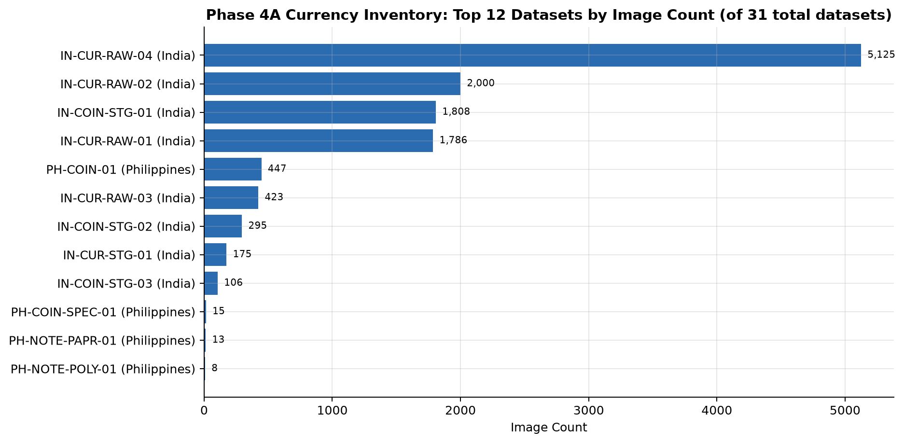
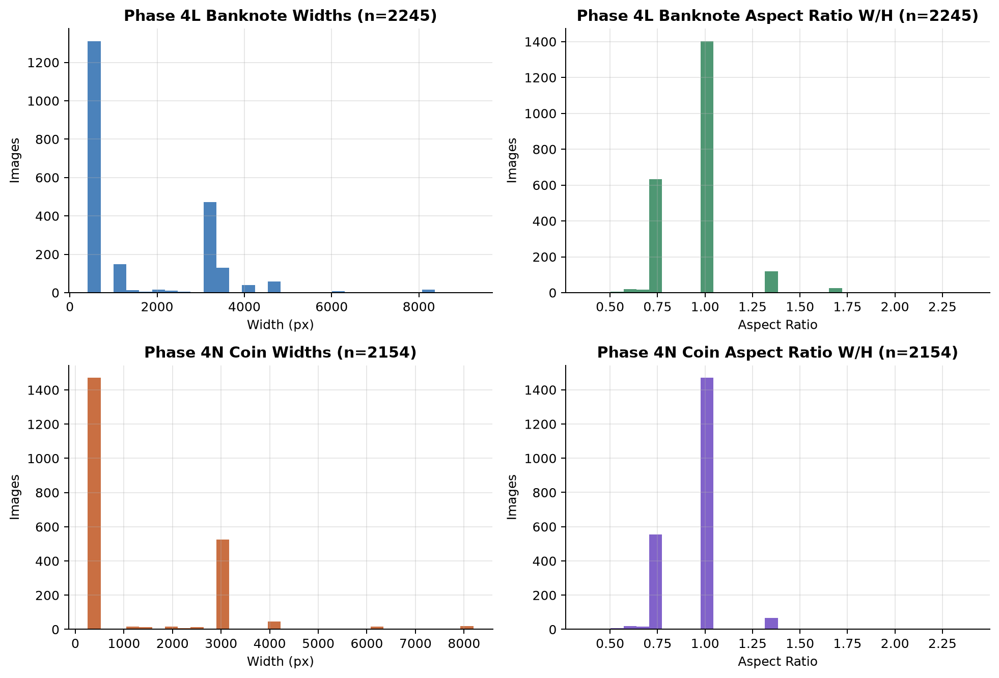
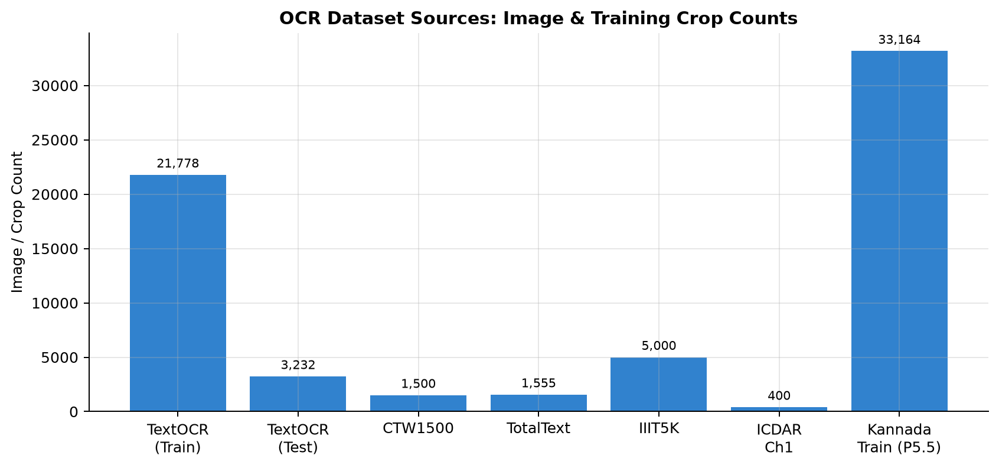

# DATASET ENGINEERING REPORT

## 1. Currency Dataset Preparation & Provenance
- **Phase 4A Inventory:** Catalogued 31 datasets (`PHASE4A_DATASET_INVENTORY.json`).
- **Phase 4B.3.2 & 4B.3.2.9:** Separated algorithmic pseudo-labels from genuine human-reviewed specimens and corrected source-identity mismatches.
- **Phase 4L Banknotes & Phase 4N Coins:** Enforced `burst_group_id` split isolation, SHA-256/dHash/pHash deduplication, and quarantine of ambiguous coin crops (`manifest_coin_train_val_clean_quarantined.csv`).

## 2. OCR Dataset Audit & Shaping Correction
- **Raw Corpus Reconciliation (`ocr_audit_summary.json`):** Verified `1,052,354` TextOCR train annotations (explaining the 9-annotation literature discrepancy vs `1,052,363`) and `0` Kannada/Hindi instances in raw English corpora.
- **Synthetic Shaping Fix (Phase 5.11.1 -> 5.11.2):** Identified unshaped PIL Kannada rendering (detached vowel signs) in early synthetic scenes and replaced them with HarfBuzz-shaped renders (`shaped_scenes`).

