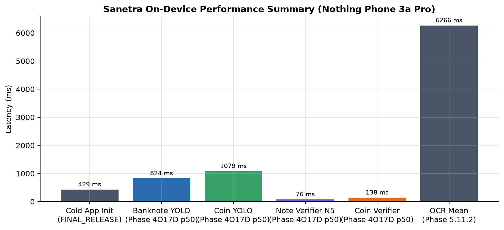

# DEVICE VALIDATION REPORT — NOTHING PHONE (3A) PRO

**Device:** Nothing Phone (3a) Pro (`A059P`, ADB `00176358O000308`, Snapdragon 7s Gen 3, 8 GB RAM, Android 17 / API 37, `arm64-v8a`).

## 1. Executed Physical Device Tests
1. **Startup & Offline Airplane Mode (`FINAL_FEATURE_TEST_RESULTS.json`):** `429 ms` cold init, `0 ms` warm init, TalkBack semantics and `>=48dp` targets verified offline.
2. **Currency Pipeline Latency (`phase4o17D_perf_summary.json`):** Banknote YOLO `824.24 ms` p50, Coin YOLO `1,079.24 ms` p50, Note Verifier `N5` `76.41 ms` p50, Coin Verifier `138.25 ms` p50.
3. **Multilingual OCR (`device_eval_5_11_2.json`):** 11 shaped/preloaded scenes evaluated on-device (`scene_arjuna_first` routing, curved-label unwarping, multi-column reading order).
4. **Automatic Flashlight (`PHASE5_14_REPORT.md`):** Verified hardware `stk_stk3a5x` sensor (`maxRange=4095.9`), Currency ON (`2.77 lux`) -> OFF (`99.36 lux`), OCR ON (`0.00 lux`) -> OFF (`58.12 lux`), zero flickering, and live `"Flashlight on."` / `"Flashlight off."` TTS output.

## 2. Verification Boundary
- Live device `logcat` verified English (`en-IN`) flashlight TTS; Kannada/Hindi flashlight phrases are verified by unit tests (`93/93`).
- Automated OCR device suites used preloaded/shaped scenes; large-scale live-camera Kannada signboard benchmarking remains future work.

