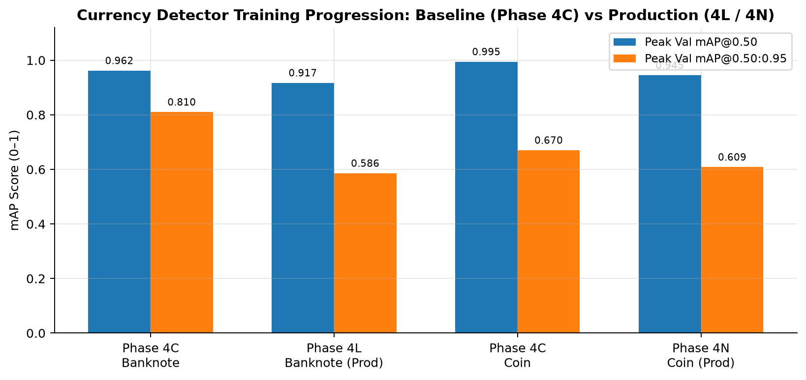
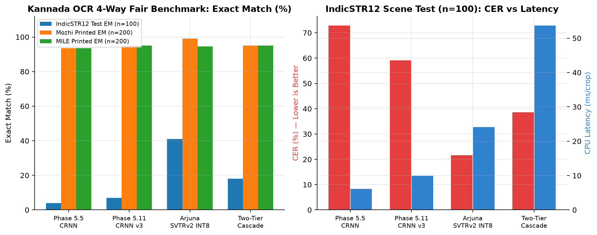
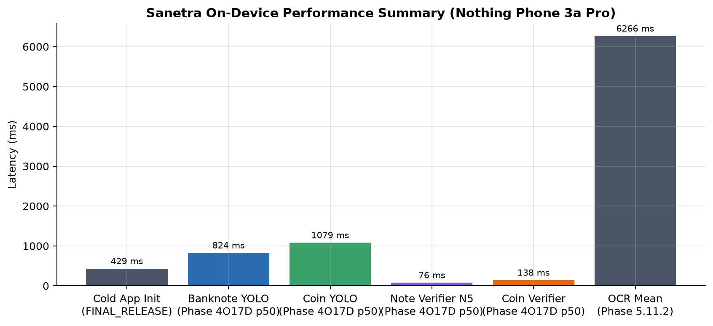

# SANETRA — MASTER PROJECT REPORT

**Previous Project Name:** VisionMission  
**Android Package ID:** `com.visionassistant.vision_assistant.visionmission`  
**Primary Validation Device:** Nothing Phone (3a) Pro (`00176358O000308`, Android 17 / API 37)  
**Date:** 16 November 2026  

---

## 1. Executive Summary
**Sanetra** is an offline Android assistive vision application built with Flutter, Kotlin, and ONNX Runtime for blind and visually impaired users in India. Operating without internet connectivity, it unifies:
- **Indian Currency Recognition:** 6 banknote denominations (`₹10`–`₹500`) and 4 coin denominations (`₹1`–`₹10`) via YOLOv8n detectors (`Phase 4L` `0.952 mAP@0.50`; `Phase 4N` `0.937 mAP@0.50`), MobileNetV3-Small identity verifiers (`N5` `99.04%` val accuracy, `100%` foreign-note rejection; `Coin 4O10` `99.88%` val accuracy), and temporal tracking.
- **Multilingual Scene & Document OCR:** PP-OCRv5 Mobile text detection (`detector.onnx`) with English, Hindi, and dual-model Kannada recognition (`Arjuna SVTRv2 INT8` scene-first routing at `41.00%` `IndicSTR12` exact match / `99.00%` `Mozhi` exact match, plus `CRNN v3` for clean printed pages), curved-label unwarping, and reading-order sorting.
- **Hands-Free Accessibility:** Hardware volume-button gestures (2s mode switch with auto-OCR, 450ms double-press reread, 2s Volume Down 4s language selector), serialized offline Google TTS (`en-IN`, `kn-IN`, `hi-IN`), and automatic ambient-light flashlight control (`Sensor.TYPE_LIGHT`).

---

## 2. Introduction & Problem Statement
Blind and low-vision users face daily barriers when identifying Indian currency denominations, verifying mixed notes/coins, and reading printed or signboard text in English, Kannada, and Hindi. Cloud-dependent assistive apps fail in low-connectivity environments and introduce latency and privacy concerns. Sanetra addresses this by executing all detection, verification, OCR, and speech synthesis locally on an Android smartphone.

---

## 3. Objectives
1. Deliver accurate, real-time offline Indian banknote and coin detection with foreign-currency and background rejection.
2. Provide offline English, Kannada, and Hindi OCR capable of handling curved labels, tilted/rotated text, and multi-column layouts.
3. Implement hands-free hardware volume-key controls, serialized multilingual TTS, and automatic low-light flashlight control.
4. Validate all models and UX flows on physical Android hardware (`Nothing Phone (3a) Pro`, `00176358O000308`).

---

## 4. System Architecture
```text
+-----------------------------------------------------------------------+
|                    SANETRA ANDROID APP (Flutter + Kotlin)             |
|  Package: com.visionassistant.vision_assistant.visionmission          |
+-----------------------------------+-----------------------------------+
        +---------------------------+---------------------------+
        v                           v                           v
+---------------+         +-------------------+       +-----------------+
| Currency Mode |         |     OCR Mode      |       | Hardware & UX   |
| Live YUV +    |         | Auto Capture +    |       | - Vol Keys (Kt) |
| Snapshot      |         | 450ms Reread      |       | - 4s Lang Popup |
+-------+-------+         +---------+---------+       | - TYPE_LIGHT    |
        v                           v                 |   Auto-Torch    |
+---------------+         +-------------------+       +--------+--------+
| YOLOv8n ONNX  |         | PP-OCRv5 Det ONNX |                |
| Banknote (4L) |         | + Geometry /      |                |
| Coin (4N)     |         |   Reading Order   |                |
+-------+-------+         +---------+---------+                |
        v                           v                          |
+---------------+         +-------------------+                |
| MobileNetV3   |         | EN / HI PP-OCRv5  |                |
| Verifier N5 / |         | KA CRNN + Arjuna  |                |
| Coin 4O10     |         | SVTRv2 Scene-1st  |                |
+-------+-------+         +---------+---------+                |
        +-------------+-------------+--------------------------+
                      v
        +-----------------------------------+
        | SpeechService (_serialQueue)      |
        | Offline Google TTS (en/kn/hi-IN)  |
        +-----------------------------------+
```

---

## 5. Hardware & Software Requirements
- **Device:** Android `arm64-v8a` smartphone with rear camera, LED flash, and hardware ambient-light sensor (validated on Nothing Phone (3a) Pro, Snapdragon 7s Gen 3, 8 GB RAM, Android 17 / API 37).
- **Software:** Flutter (Dart `^3.13.7`), Kotlin Android channels, `flutter_onnxruntime ^1.9.0`, `camera ^0.12.2`, `flutter_tts ^4.2.5`, Google Offline TTS (`en-IN`, `kn-IN`, `hi-IN`).

---

## 6. Dataset Engineering Summary
- **Currency Datasets:** 31 raw/staged sources inventoried (Phase 4A). Strict burst-group (`burst_group_id`) train/val isolation, SHA-256/dHash/pHash deduplication, and quarantine of ambiguous coin crops (Phases 4B, 4L, 4N). Human-reviewed specimens (`PHASE4B_3_2_REVIEW_SUMMARY.json`) are strictly separated from algorithmic pseudo-labels.
- **OCR Datasets:** Audited `1,081,819` raw instances (`TextOCR`, `CTW1500`, `TotalText`, `IIIT5K`, `ICDAR`), revealing `0` Kannada and `0` Hindi instances in raw English corpora. Built a `33,164`-crop Kannada training set (`train.json`) and evaluated on held-out `IndicSTR12`, `Mozhi`, and `MILE`.
- *Detailed manifests and histograms:* See [DATASET_ENGINEERING_REPORT.md](../02_SUBSYSTEM_REPORTS/DATASET_ENGINEERING_REPORT.md) and `03_DATASET_DOCUMENTATION/`.

---

## 7. Currency Subsystem Summary
Two-stage detection (`YOLOv8n` `640x640`) + identity verification (`MobileNetV3-Small` `224x224`) + temporal smoothing (`BanknoteTracker`, `CurrencySafetyEvaluator`):
- **Banknote Detector (Phase 4L):** Peak `mAP@0.50 = 0.952` (Phase 4L Val164) and `0.946` (Val100), up from `0.693` for the legacy Phase 4C ONNX model.
- **Coin Detector (Phase 4N):** `mAP@0.50 = 0.937`, `Precision = 0.952`, `Recall = 0.838` on Phase 4N Val (`n=281`).
- **Identity Verifiers:** Note Verifier `N5` (`99.04%` val accuracy, `100%` foreign-note rejection on `219` foreign samples at `0.85/0.10`); Coin Verifier `4O10` (`99.88%` val accuracy).
- *Full class-wise metrics & confusion matrices:* See [CURRENCY_FINAL_REPORT.md](../02_SUBSYSTEM_REPORTS/CURRENCY_FINAL_REPORT.md).



---

## 8. OCR Subsystem Summary
- **Pipeline:** `PP-OCRv5` Mobile DBNet detector (`4.60 MB`) -> geometry/orientation rectification -> script routing (`English` `7.48 MB`, `Hindi` `7.57 MB`, `Kannada`).
- **Key Architectural Decision (Phase 5.11.1 -> 5.11.2):** Fair 4-way evaluation proved that confidence-gated CRNN->Arjuna fallback hurt scene OCR (`18.00%` EM / `38.65%` CER on `IndicSTR12_test`) because `CRNN v3` was overconfident when wrong (`ECE = 0.682`). Switching to `scene_arjuna_first` (`Arjuna SVTRv2 INT8`, `19.99 MB`) raised `IndicSTR12_test` to **`41.00%` EM / `21.67%` CER** (`24.11 ms/crop`) while achieving **`99.00%` EM / `0.14%` CER** on `Mozhi (200)`.
- *Full benchmarks & reading-order details:* See [OCR_FINAL_REPORT.md](../02_SUBSYSTEM_REPORTS/OCR_FINAL_REPORT.md).



---

## 9. Training History & Model Evaluation Summary
- Recovered **1,128 genuine epoch rows** across **24 complete training runs** (15 YOLOv8n + 9 MobileNetV3-Small verifiers) in `05_TRAINING_HISTORY/EPOCH_METRICS_MASTER.csv`.
- Epoch-wise OCR logs were not persisted (`train_metrics.json` stores final summary metrics only) and are explicitly marked `UNAVAILABLE`.
- *Full training curves & confusion matrices:* See [MODEL_TRAINING_AND_EVALUATION.md](../02_SUBSYSTEM_REPORTS/MODEL_TRAINING_AND_EVALUATION.md) and `04_MODEL_DOCUMENTATION/`.

---

## 10. Android Application & Offline Audio Summary
- **UX & Branding:** Renamed to **Sanetra** (Phase 5.13) while preserving `com.visionassistant.vision_assistant.visionmission`.
- **Controls:** 2s Volume Up mode switch + auto-OCR (Phase 5.10), 450ms double-press OCR reread (Phase 5.12), 2s Volume Down 4s preemptive language selector (Phases 5.9–5.10), and automatic `stk_stk3a5x` `TYPE_LIGHT` flashlight control across both modes (Phase 5.14).
- **Audio:** Serialized epoch-guarded `SpeechService` using offline Google TTS (`en-in-x-enc-local`, `kn-in-x-knd-local`, `hi-in-x-hia-local`).
- *Details:* See [ANDROID_APPLICATION_REPORT.md](../02_SUBSYSTEM_REPORTS/ANDROID_APPLICATION_REPORT.md) and [OFFLINE_AUDIO_AND_TTS_REPORT.md](../02_SUBSYSTEM_REPORTS/OFFLINE_AUDIO_AND_TTS_REPORT.md).

---

## 11. Physical Device Validation & Results
Validated on **Nothing Phone (3a) Pro (`00176358O000308`)**:
- **Startup & Offline:** `429 ms` cold init; airplane-mode offline operation verified (`FINAL_FEATURE_TEST_RESULTS.json`).
- **Currency Latency (Phase 4O17D):** Banknote YOLO `824 ms` p50, Coin YOLO `1,079 ms` p50, Note Verifier `N5` `76 ms` p50, Coin Verifier `138 ms` p50.
- **OCR On-Device (Phase 5.11.2):** 11 shaped/curved/rotated/2-column scenes verified (`device_eval_5_11_2.json`).
- **Auto-Flashlight (Phase 5.14):** Live `logcat` confirmed automatic ON/OFF and `"Flashlight on."` / `"Flashlight off."` announcements in both Currency (`2.77` -> `99.36 lux`) and OCR (`0.00` -> `58.12 lux`) modes.
- **Regression:** `flutter analyze lib test` = `0` issues; `flutter test` = `93 / 93` passing.
- *Full device test record:* See [DEVICE_VALIDATION_REPORT.md](../02_SUBSYSTEM_REPORTS/DEVICE_VALIDATION_REPORT.md).



---

## 12. Limitations
1. Wild scene Kannada OCR (`IndicSTR12_test`) reaches `41.00%` word exact match (`21.67%` CER), below printed-document accuracy (`95–99%`).
2. Epoch-by-epoch OCR training logs are unavailable (`train_metrics.json` retains summary metrics only).
3. Automated OCR device suites (`Phase 5.11.2`) used shaped/preloaded scenes rather than a large-scale live-camera signboard ground-truth corpus.
4. Release APKs use development signing (`production_keystore_configured: false`) and are not published to Google Play.
5. Phase 5.14 Kannada/Hindi flashlight TTS phrases were verified in unit tests (`93/93`), while live device `logcat` verified English (`en-IN`).

---

## 13. Conclusion & Future Work
Sanetra delivers a verified, fully offline assistive vision pipeline for Indian currency recognition, multilingual OCR, and hands-free audio guidance on Android. Future work includes collecting a live-camera Kannada signboard benchmark, persisting epoch-level OCR training logs, configuring a Google Play release keystore, and conducting field trials with visually impaired users.

---

## 14. Evidence Index
All figures, metrics, and claims trace to `08_EVIDENCE_AND_REGISTERS/EVIDENCE_REGISTER.csv`, `METRIC_PROVENANCE_REGISTER.csv`, `PLOT_CATALOG.csv`, and `FINAL_FILE_MANIFEST.csv`.
