# MODEL TRAINING AND EVALUATION REPORT

## 1. Genuine Epoch History Coverage
- **Complete Runs (24 runs, 1,128 epoch rows):** 15 Ultralytics YOLOv8n runs (`phase4c`, `phase4g`, `phase4l`, `phase4n`, `phase4o5`, `phase4o5_1`, `phase4o6 D0–D4`) + 9 MobileNetV3-Small verifier runs (`phase4o10`, `phase4o11 N1–N3`, `phase4o15 N4–N6, C2`).
- **Unavailable / Pretrained Runs (4 runs):** Phase 5.5 Kannada CRNN (`train_metrics.json` summary only), Phase 5.11 experimental CRNN, pretrained PP-OCRv5, and pretrained Arjuna SVTRv2.

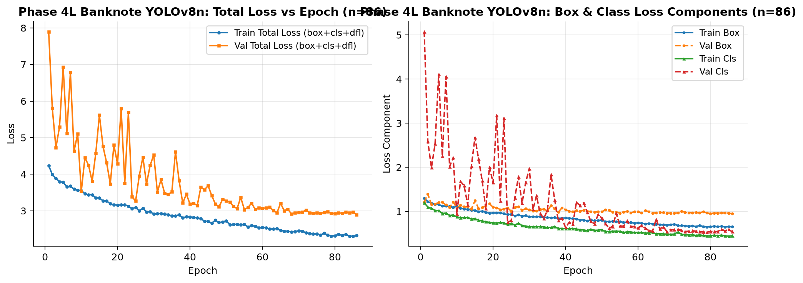
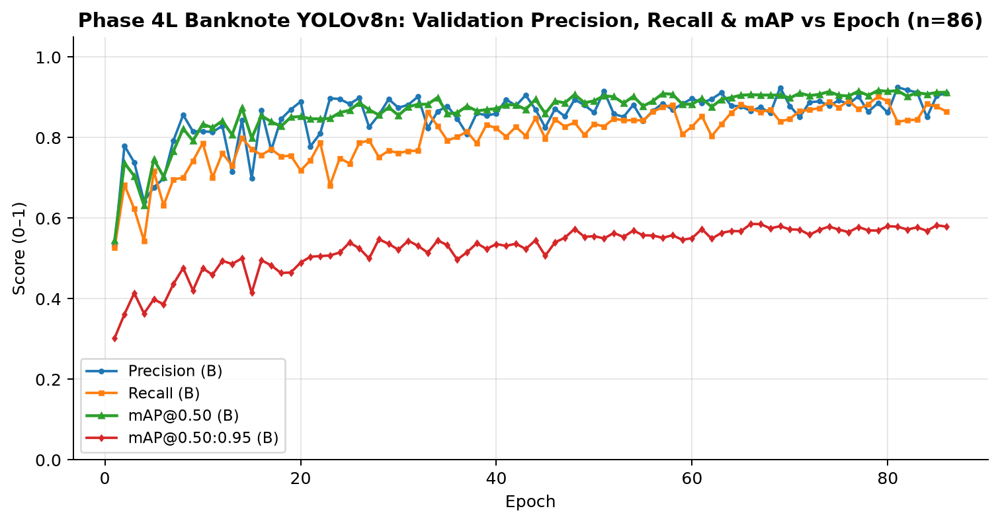
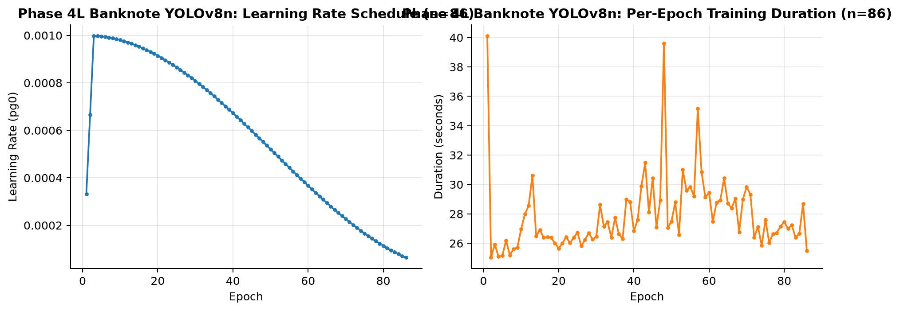
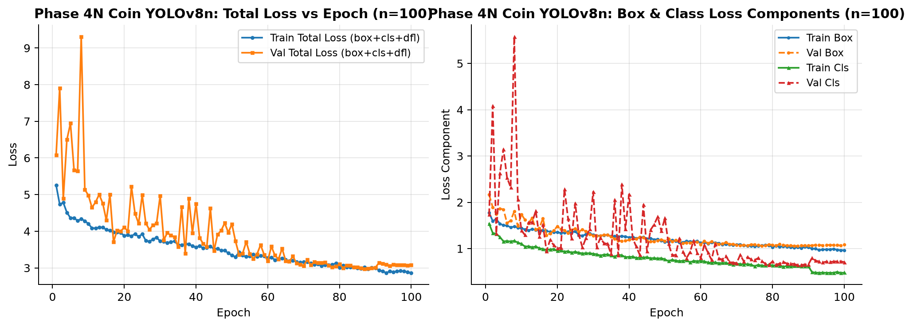
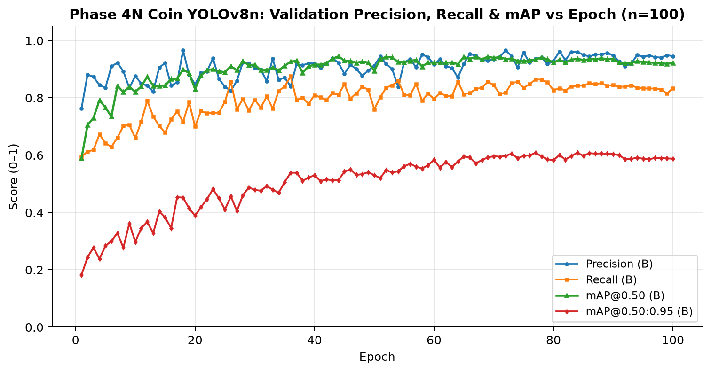
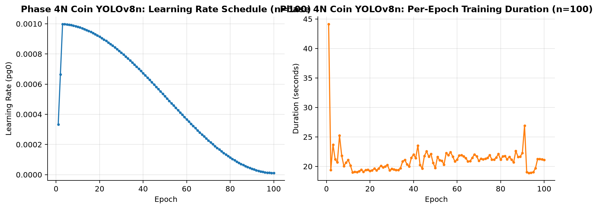
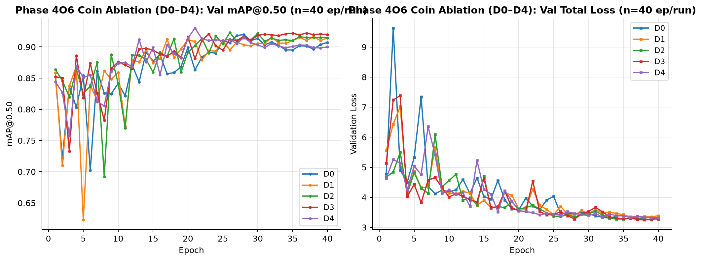
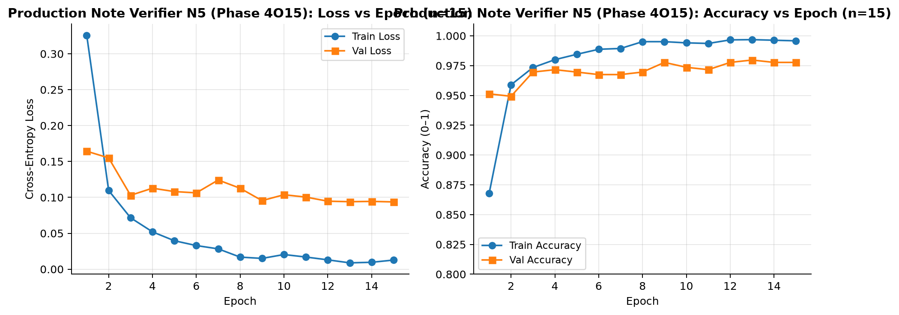
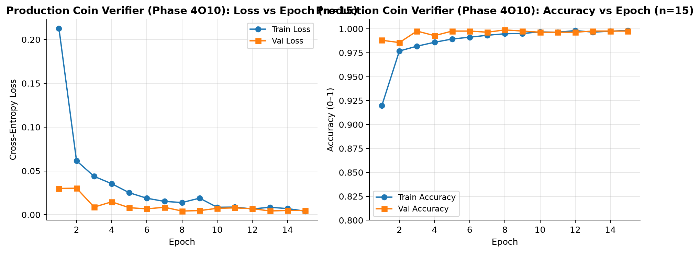
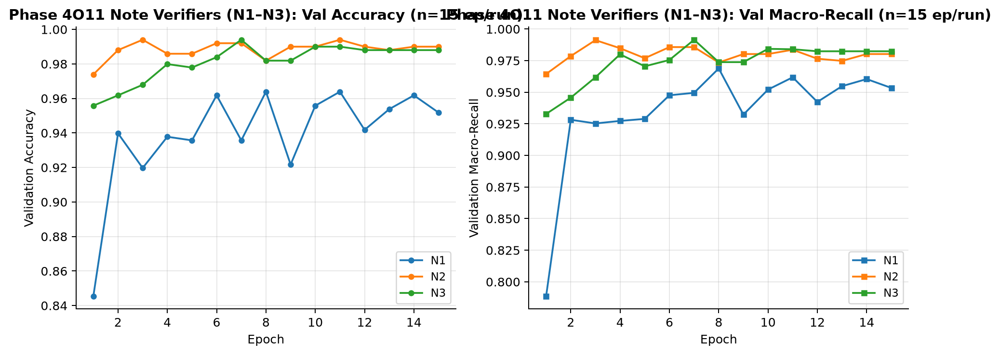
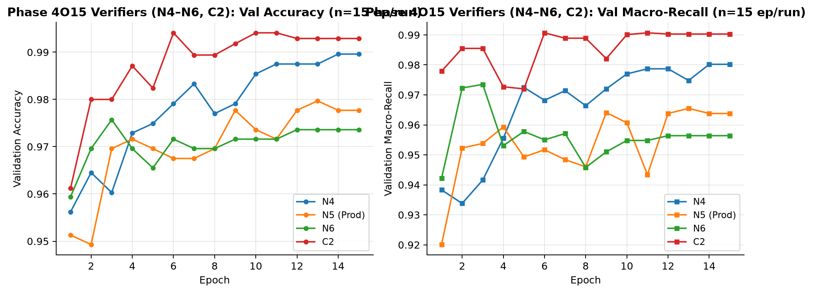

## 2. Confusion Matrices & Verifier Comparison
Raw and row-normalized confusion matrices and per-class precision/recall/F1 (`VERIFIER_CLASSIFICATION_REPORT.csv`) cover all 9 verifier models.

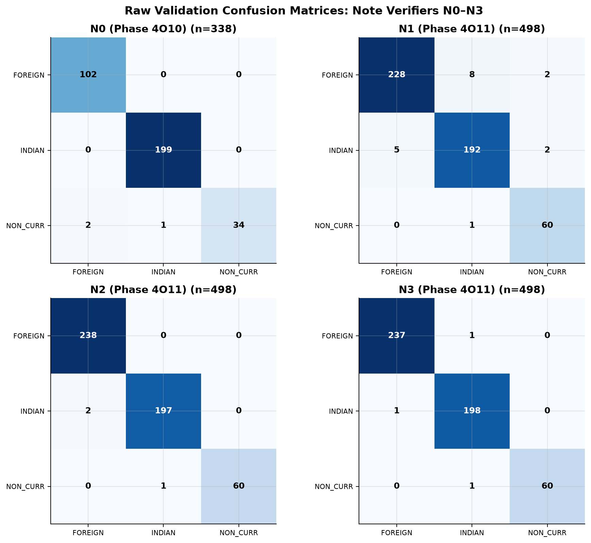
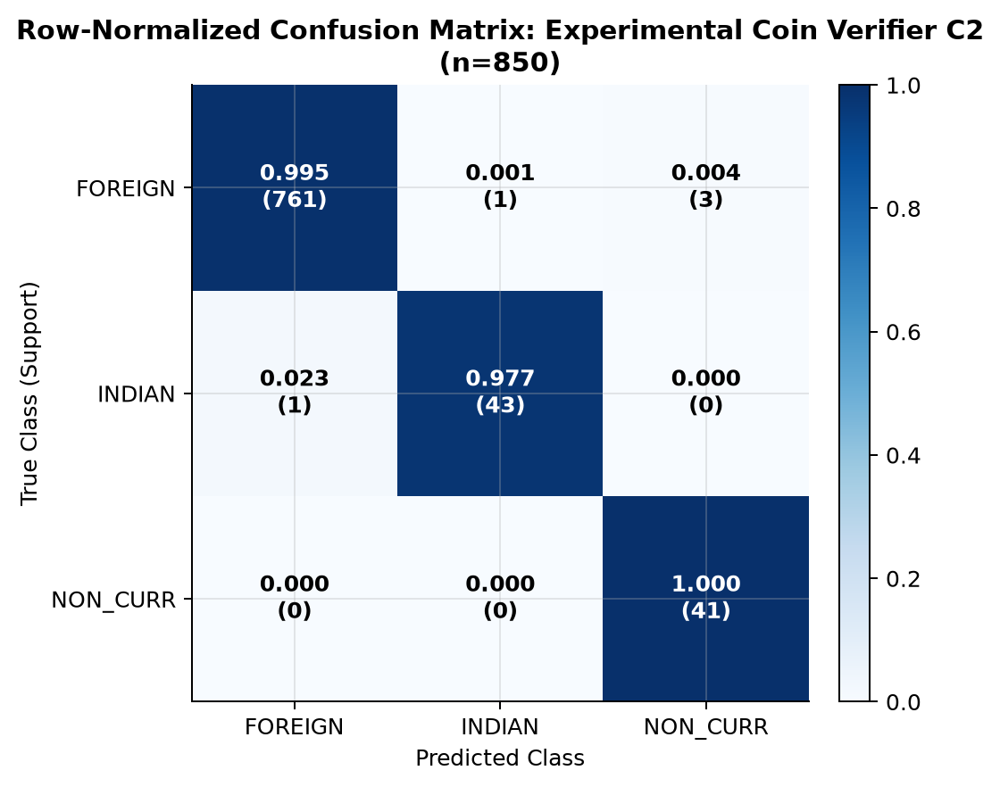
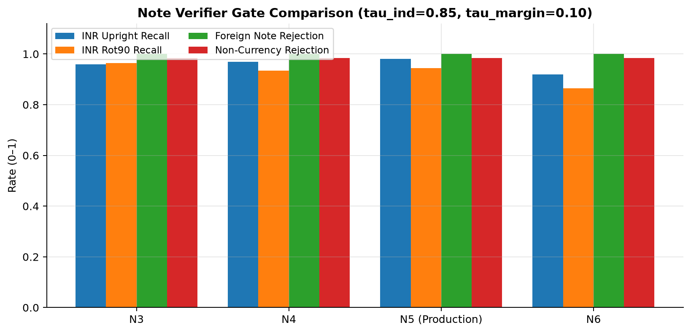
