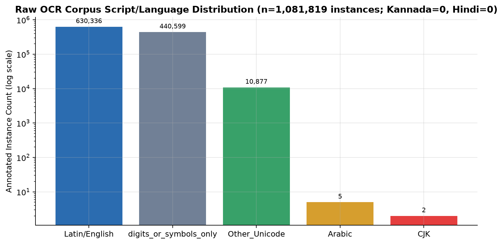
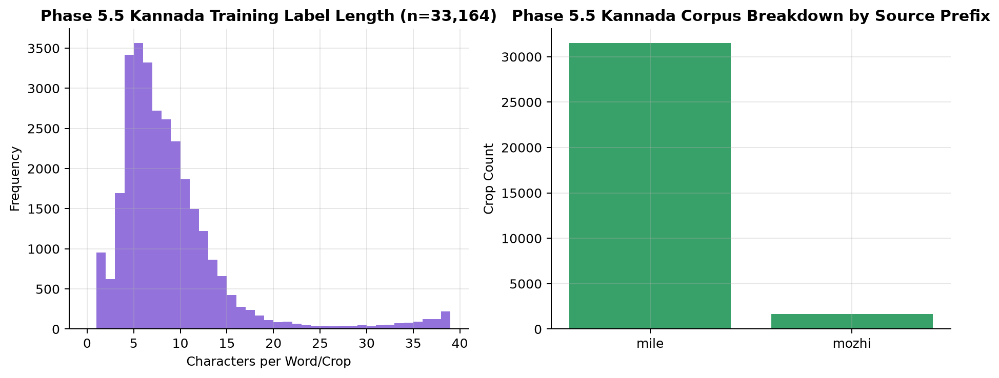
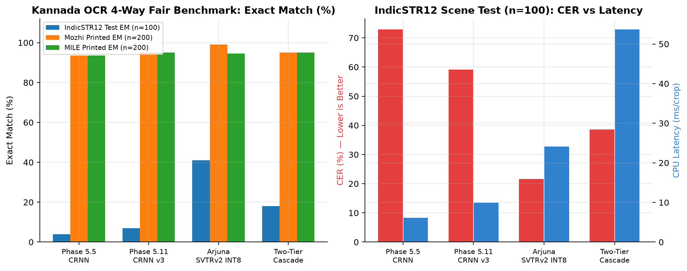
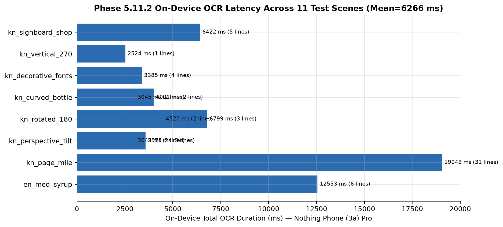

# OCR SUBSYSTEM FINAL REPORT

## 1. Multilingual Architecture & Production Routing
Sanetra supports offline **English (`en-IN`)**, **Kannada (`kn-IN`)**, and **Hindi (`hi-IN`)** OCR:
- **Detector:** `PP-OCRv5` Mobile DBNet (`detector.onnx`, `4.60 MB`, dynamic `Bx3xHxW`).
- **English Recognizer:** `PP-OCRv5` Mobile (`recognizer.onnx`, `7.48 MB`, `Bx3x48xW`, 436+2 dict).
- **Hindi Recognizer:** `PP-OCRv5` Mobile (`recognizer_hi.onnx`, `7.57 MB`, `Bx3x48xW`, 568+2 dict).
- **Kannada Recognizers (Phase 5.11.2 `scene_arjuna_first`):**
  - Scene/curved/angled text: `Arjuna SVTRv2 INT8` (`recognizer_ka_scene.onnx`, `19.99 MB`, `Bx3x32xW`, 220+1 charset).
  - Clean printed documents: Kannada CRNN (`recognizer_ka.onnx`, `10.55 MB`, `Bx3x48xW`, 163+2 dict).

## 2. Dataset Audit & Corpus Composition
- Raw English/scene corpus (`ocr_audit_summary.json`) contains `1,052,354` TextOCR train annotations plus CTW1500, TotalText, IIIT5K, and ICDAR — with **0 Kannada** and **0 Hindi** instances.
- Phase 5.5 Kannada training set (`train.json`) comprises `33,164` cropped word images (MILE, Mozhi, and augmented samples).

## 3. Model Selection: Why Scene-First Replaced the Two-Tier Cascade
The Phase 5.11.1 fair 4-way benchmark demonstrated that gating `Arjuna SVTRv2` behind `CRNN v3` confidence hurt scene accuracy and doubled latency:
- **IndicSTR12 Test (`n=100`):** `Arjuna SVTRv2 INT8` achieved **`41.00%` EM / `21.67%` CER** (`24.11 ms/crop`) vs **`18.00%` EM / `38.65%` CER** (`53.70 ms/crop`) for the Two-Tier Cascade (`CRNN v3` overconfidence `ECE = 0.682`).
- **Clean Printed (`Mozhi 200` / `MILE 200`):** `Arjuna` achieved `99.00%` EM (`0.14%` CER) on `Mozhi`; `CRNN v3` achieved `95.00%` EM on both `Mozhi` (`0.68%` CER) and `MILE` (`0.48%` CER) at `7.5–9.2 ms/crop`.

## 4. Geometry, Reading Order & On-Device Performance
- Phase 5.11.2 resolved curved-label endpoint clipping in `ocr_postprocessing.dart`, added 90°/180°/270° orientation correction, and ordered multi-column regions.
- Across 11 shaped/preloaded scenes on Nothing Phone (3a) Pro (`device_eval_5_11_2.json`), all scenes completed offline and fed `SpeechService.speakOcrLines`.
- **Limitations:** Held-out wild scene Kannada (`IndicSTR12`) remains at `41.00%` EM; epoch-wise OCR training logs were not persisted (`train_metrics.json` retains final summary metrics only).

